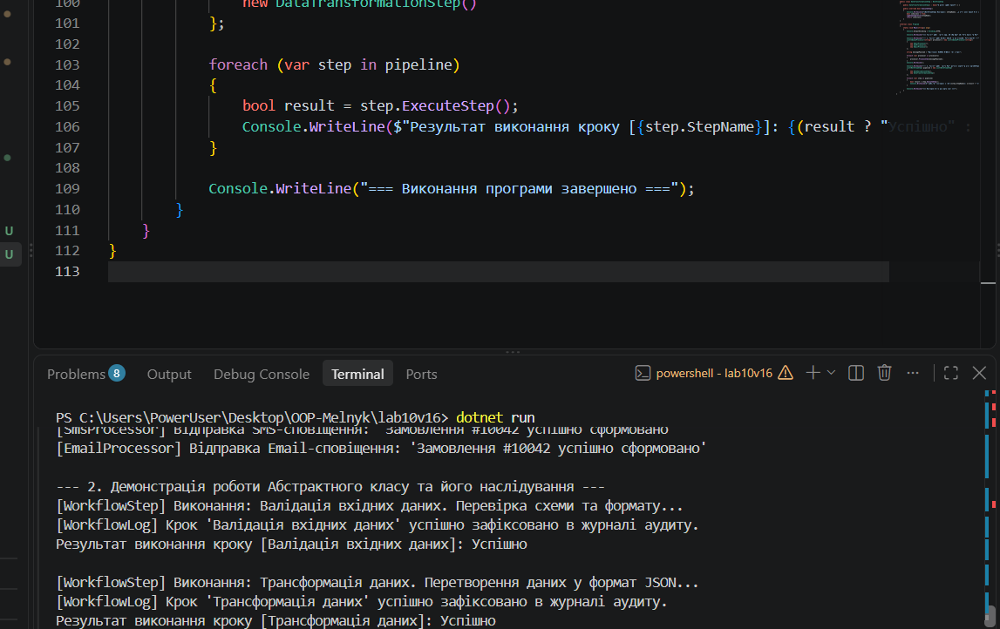

# Лабораторна робота №10

**Тема:** Абстрактні класи та інтерфейси. Контракти та реалізації.  
**Студентка:** Мельник Ангеліна, група КН-3/1  
**Варіант:** 16 (`IQueueProcessor<T>` та `WorkflowStep`)

## Мета роботи
Навчитися створювати та використовувати абстрактні класи та інтерфейси для визначення контрактів та реалізації спільної логіки, а також розуміти критерії вибору між ними.

## Хід роботи
1. Створено консольний проєкт `lab10v16` за допомогою .NET SDK.
2. Реалізовано інтерфейс `IQueueProcessor<T>` та 2 класи, що його реалізують (`EmailProcessor`, `SmsProcessor`).
3. Реалізовано абстрактний клас `WorkflowStep` з абстрактним методом `ExecuteStep()` та конкретним методом `LogStepCompletion()`.
4. Створено 2 похідні класи (`DataValidationStep`, `DataTransformationStep`), які перевизначають абстрактний метод та використовують логіку базового класу.
5. У методі `Main` продемонстровано поліморфні виклики через колекції типів інтерфейсу та абстрактного класу.

## Результат виконання програми

