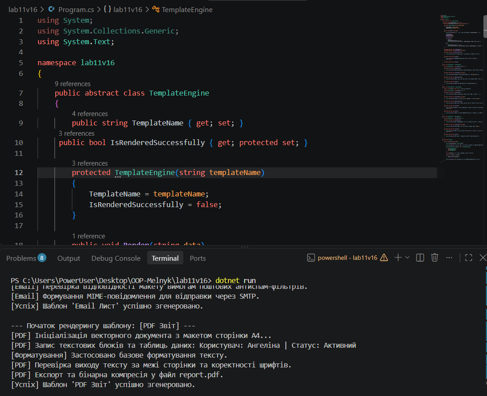

# Лабораторна робота №11

**Тема:** DocumentProcessor: шаблонні кроки й реалізації (Патерн Template Method).  
**Студентка:** Мельник Ангеліна, група КН-3/1  
**Варіант:** 16 (`TemplateEngine`: `HTMLTemplate`, `EmailTemplate`, `PDFTemplate`)

## Мета роботи
Навчитися використовувати абстрактні класи для реалізації патерну Template Method, створювати загальну логіку обробки в базовому класі та специфічну логіку в похідних класах.

## Хід роботи
1. Створено консольний проєкт `lab11v16` за допомогою .NET SDK.
2. Реалізовано абстрактний клас `TemplateEngine` з шаблонним методом `Render()`, який задає порядок виклику 5 кроків (`LoadTemplate`, `InjectData`, `ApplyFormatting`, `Validate`, `Output`).
3. Створено 3 похідні класи (`HTMLTemplate`, `EmailTemplate`, `PDFTemplate`), у яких реалізовано обов'язкові абстрактні кроки та за потреби перевизначено віртуальні методи.
4. У методі `Main` продемонстровано обробку списку типів `TemplateEngine` шляхом поліморфного виклику шаблонного методу.

## Результат виконання програми

