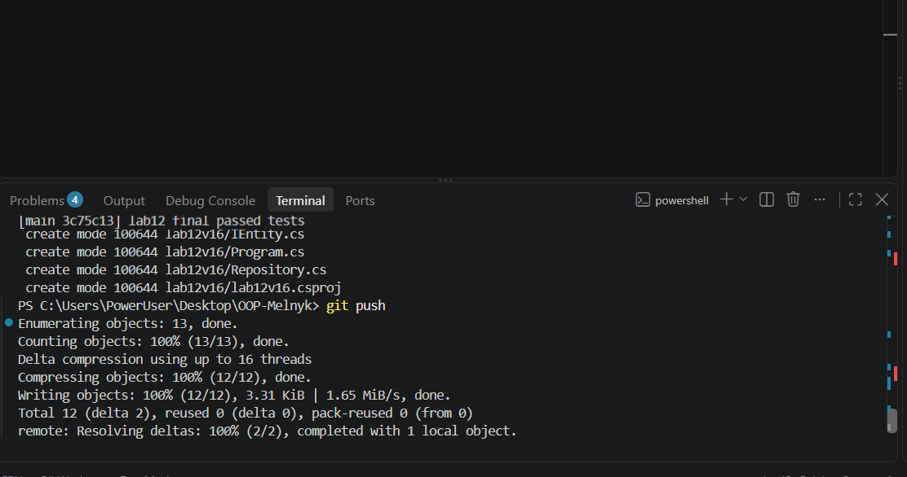

# Лабораторна робота №12

**Тема:** Узагальнені типи (Generics). IRepository з where-обмеженнями та тестами[cite: 3].  
**Студентка:** Мельник Ангеліна, група КН-3/1  
**Варіант:** 16 (`BlogPost`: поля `Id`, `Title`, `Content`, `AuthorId`)

## Мета роботи
Навчитися створювати узагальнені інтерфейси та класи, застосовувати where-обмеження для типів-параметрів, а також розробляти юніт-тести для перевірки коректності узагальнених реалізацій[cite: 3].

## Хід роботи
1. Створено основний консольний проєкт `lab12v16` та окремий проєкт для тестування `lab12v16.Tests` (на базі xUnit) за допомогою .NET SDK[cite: 3].
2. Реалізовано базовий інтерфейс `IEntity` із властивістю `Id`, сутність `BlogPost` за 16-м варіантом, а також узагальнений інтерфейс `IRepository<T>` із обмеженням `where T : IEntity`[cite: 3].
3. Створено клас `InMemoryRepository<T>`, який реалізує всі базові CRUD-операції (`GetById`, `GetAll`, `Add`, `Update`, `Delete`) для зберігання даних у пам'яті з обробкою винятків[cite: 3].
4. Написано набір юніт-тестів у проєкті `lab12v16.Tests`, що повністю покривають усі CRUD-методи, включно з перевіркою поведінки при роботі з неіснуючими ID[cite: 3].

## Результат виконання тестування

