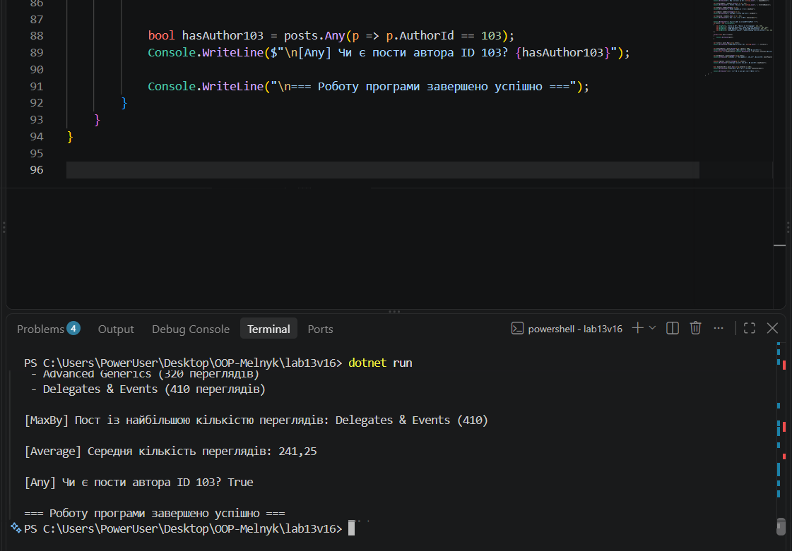

# Лабораторна робота №13

**Тема:** Generic-методи для повторного використання компонентів: Mapper/MaxBy/Reduce з Func/Action.  
**Студентка:** Мельник Ангеліна, група КН-3/1  
**Варіант:** 16 (`Map`, `Filter`, `MaxBy`, `Average`, `Any`)

## Мета роботи
Навчитися створювати узагальнені (generic) методи для повторного використання логіки, використовувати делегати Func<T> та Action<T> як параметри поведінки й реалізовувати типові операції над колекціями.

## Хід роботи
1. Створено новий консольний проєкт `lab13v16` за допомогою .NET SDK.
2. Реалізовано статичний клас `FunctionalUtils` із generic-методами за 16-м варіантом (`Map`, `Filter`, `MaxBy`, `Average`, `Any`).
3. Для обмеження типів у методі `MaxBy` використано `where TKey : IComparable<TKey>`.
4. У методі `Main` продемонстровано роботу всіх реалізованих методів на базових типах даних (`int`) та на власній сутності (`BlogPost`) з використанням лямбда-виразів.

## Результат виконання програми

