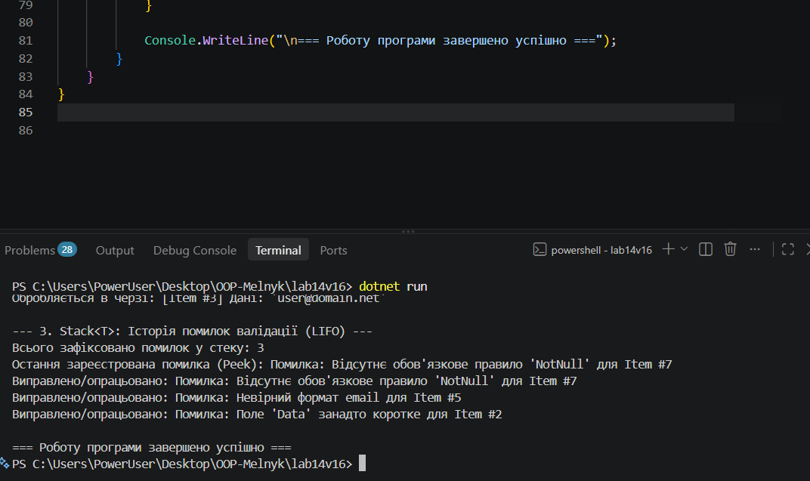

# Лабораторна робота №14

**Тема:** HashSet/Queue/Stack: практичні сценарії (Система валідації)  
**Студентка:** Мельник Ангеліна, група КН-3/1  
**Варіант:** 16 (Система валідації: `HashSet` — правила, `Queue` — черга на валідацію, `Stack` — історія помилок)

## Мета роботи
Навчитися використовувати спеціалізовані колекції `HashSet<T>`, `Queue<T>`, `Stack<T>` для розв’язання практичних задач, зрозуміти їхні особливості та сценарії застосування.

## Хід роботи
1. Створено консольний проєкт `lab14v16` за допомогою .NET SDK.
2. Реалізовано роботу з колекцією **`HashSet<T>`** для зберігання унікальних правил валідації та перевірки на відсутність дублікатів.
3. Реалізовано обробку даних за допомогою **`Queue<T>`** (дисципліна FIFO) для послідовної перевірки об'єктів у черзі (`Enqueue`, `Dequeue`, `Peek`).
4. Реалізовано управління історією помилок за допомогою **`Stack<T>`** (дисципліна LIFO) для відстеження та послідовного опрацювання помилок (`Push`, `Pop`, `Peek`).

## Результат виконання програми

