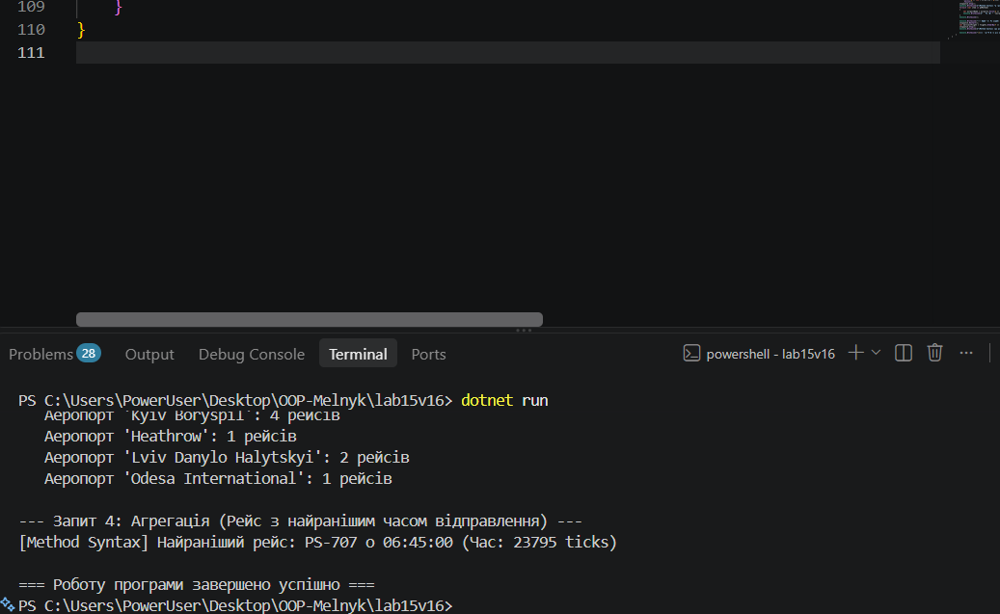

# Лабораторна робота №15

**Тема:** LINQ в дії: фільтри, join, агрегації. Продуктивність.  
**Студентка:** Мельник Ангеліна, група КН-3/1  
**Варіант:** 16 (Управління авіарейсами: сутності `Flight` та `Airport`)

## Мета роботи
Навчитися ефективно використовувати LINQ для фільтрації, об’єднання (join) та агрегації даних, а також аналізувати продуктивність LINQ-запитів за допомогою класу `Stopwatch`.

## Хід роботи
1. Створено консольний проєкт `lab15v16` за допомогою .NET SDK.
2. Створено класи сутностей `Airport` та `Flight` і заповнено колекції тестовими даними (8-10 елементів).
3. Реалізовано 4 індивідуальні запити згідно з 16-м варіантом, використовуючи як синтаксис запитів (Query Syntax), так і синтаксис методів (Method Syntax).
4. За допомогою `System.Diagnostics.Stopwatch` виміряно час виконання операцій у тіках (ticks) та виведено результати.

## Висновки про продуктивність
* Прості фільтрації та вибірки (`Where`, `Select`) виконуються найшвидше завдяки відкладеному виконанню (Deferred Execution) та лінійній складності $O(N)$.
* Операції об'єднання (`Join`) та групування (`GroupBy`) вимагають побудови внутрішніх хеш-таблиць, тому витрачають трохи більше часу порівняно з базовою фільтрацією, проте залишаються високоефективними.
* Негайне виконання агрегуючих методів (`ToList`, `Count`, `FirstOrDefault`) примусово запускає обчислення одразу.

## Результат виконання програми

