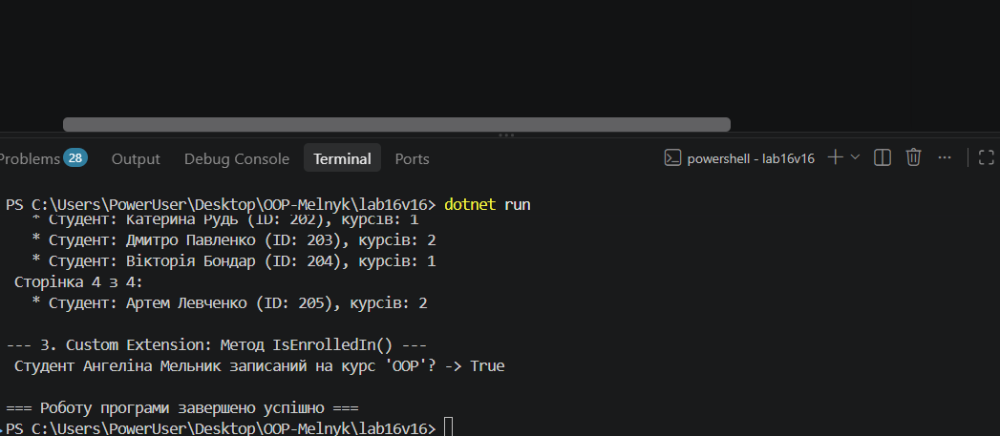

# Лабораторна робота №16

**Тема:** LINQ: SelectMany, пагінація й custom extensions  
**Студентка:** Мельник Ангеліна, група КН-3/1  
**Варіант:** 16 (Університети, студенти та курси)

## Мета роботи
Навчитися використовувати оператор `SelectMany` для роботи з вкладеними колекціями, реалізовувати пагінацію даних за допомогою LINQ, а також створювати власні методи розширення.

## Хід роботи
1. Створено консольний проєкт `lab16v16` за допомогою .NET SDK.
2. Створено класи сутностей із вкладеними колекціями (`University`, `Student`, `Course`) та заповнено тестовими даними.
3. Реалізовано запит за допомогою `SelectMany` для «розгортання» вкладених списків курсів усіх студентів.
4. Реалізовано пагінацію даних за допомогою методів `Skip()` та `Take()`.
5. Створено власний метод розширення `IsEnrolledIn()` для доменної сутності `Student` та продемонстровано його роботу в `Main`.

## Результат виконання програми
