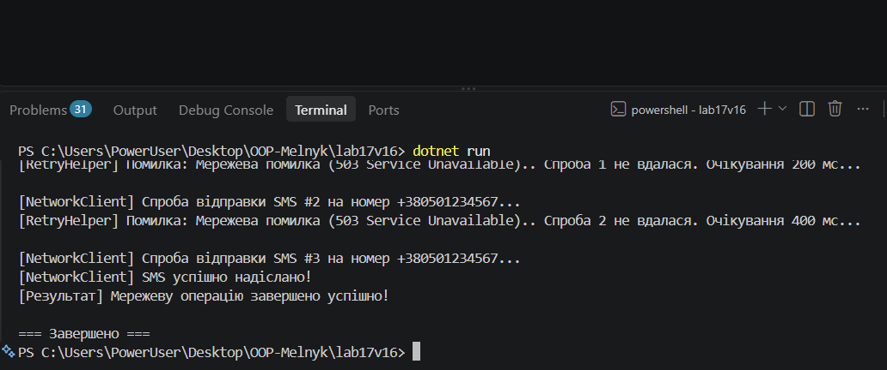

# Лабораторна робота №17

**Тема:** Обробка IO/мережевих помилок та патерн Retry  
**Студентка:** Мельник Ангеліна, група КН-3/1  
**Варіант:** 16 (Відправка SMS: `FileProcessor` та `NetworkClient`)

## Мета роботи
Навчитися обробляти типові помилки вводу/виводу (`FileNotFoundException`) та мережеві помилки (`HttpRequestException`), а також реалізувати патерн `Retry` із застосуванням експоненційної затримки та вибіркової обробки через `shouldRetry`.

## Хід роботи
1. Створено новий консольний проєкт `lab17v16` за допомогою .NET SDK.
2. Реалізовано клас `FileProcessor` із методом `GetSmsTemplate`, який імітує виникнення `FileNotFoundException` перші 3 спроби.
3. Реалізовано клас `NetworkClient` із методом `SendSms`, який імітує виникнення `HttpRequestException` перші 2 спроби.
4. Створено узагальнений допоміжний клас `RetryHelper` із методом `ExecuteWithRetry<T>`, який містить логіку повторних спроб, експоненційну затримку (`initialDelay * 2^(attempt-1)`), логування та обробку через делегат `shouldRetry`.
5. Продемонстровано роботу обох класів у методі `Main` із переходом від початкових помилок до успішного виконання операцій.

## Висновок
Експоненційна затримка у патерні Retry реалізована за формулою множення початкового часу очікування на ступінь двійки залежно від номеру спроби ($initialDelay \times 2^{attempt-1}$). Це дозволяє поступово збільшувати інтервал між запитами, даючи змогу зовнішнім сервісам чи файловій системі відновитися після тимчасових збоїв, не створюючи при цьому зайвого навантаження частими повторними запитами.

## Результат виконання програми

