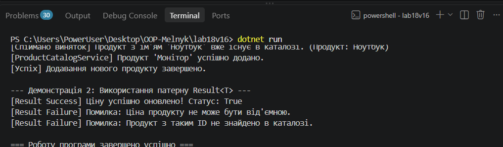

# Лабораторна робота №18

**Тема:** Власні винятки та патерн Result  
**Студентка:** Мельник Ангеліна, група КН-3/1  
**Варіант:** 16 (Управління продуктами)

## Мета роботи
Навчитися створювати власні типи винятків для специфічних помилок, а також реалізовувати патерн `Result` для більш контрольованої обробки помилок без використання винятків у "нормальних" сценаріях невдачі.

## Хід роботи
1. Створено консольний проєкт `lab18v16` за допомогою .NET SDK.
2. Реалізовано власний виняток `ProductAlreadyExistsException`, який успадковується від `Exception` та містить додаткову властивість `ProductName` і стандартні конструктори.
3. Реалізовано узагальнений клас `Result<T>` із властивостями `IsSuccess`, `Value`, `Error` та фабричними методами `Success`, `Failure` (включно з перевантаженням для обробки `Exception`).
4. Створено клас сервісу `ProductCatalogService`, де метод `AddProduct` кидає виняток при спробі додати вже наявний продукт, а метод `UpdateProductPrice` повертає `Result<bool>` для контролю очікуваних помилок (невалідний ID або від'ємна ціна).
5. Продемонстровано роботу обох підходів у методі `Main` із використанням блоків `try-catch` та перевіркою `IsSuccess`/`Error`.

## Висновок
Використання винятків доцільно для виняткових, непередбачуваних критичних ситуацій (наприклад, дублювання унікальних даних). Патерн `Result` є набагато ефективнішим і чистішим рішенням для очікуваних сценаріїв бізнес-логіки (перевірка валідності вхідних даних чи пошук елемента), оскільки він не витрачає ресурси на побудову стека викликів і робить код передбачуваним.

## Результат виконання програми

