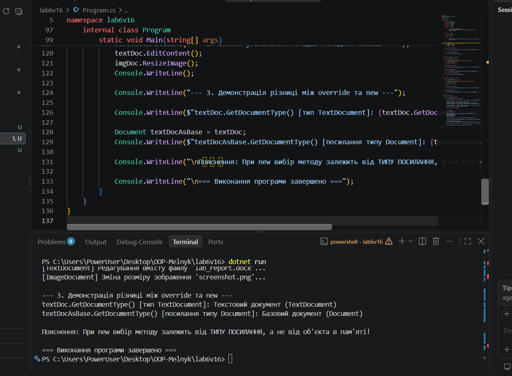

# Лабораторна робота №6

**Тема:** Наслідування. Ключові слова base, override, virtual. Приховування членів (new).  
**Студентка:** Мельник Ангеліна, група КН-3/1  
**Варіант:** 16 (Ієрархія `Document` -> `TextDocument` -> `ImageDocument`)

## Мета роботи
Навчитися створювати ієрархії класів, використовувати ключові слова `base`, `virtual`, `override` для реалізації поліморфізму, а також зрозуміти відмінності між `override` та приховуванням членів за допомогою `new`.

## Хід роботи
1. Створено консольний проєкт `lab6v16` за допомогою .NET SDK.
2. Реалізовано базовий клас `Document` з полами, властивостями, віртуальним методом `Open()` та невіртуальним методом `GetDocumentType()`.
3. Реалізовано похідні класи:
   - `TextDocument`: перехоплює конструктор через `base(...)`, перевизначає `Open()`, має власний метод `EditContent()` та приховує метод `GetDocumentType()` за допомогою ключового слова `new`.
   - `ImageDocument`: перехоплює конструктор через `base(...)`, перевизначає `Open()` та має власний метод `ResizeImage()`.
4. У методі `Main` продемонстровано поліморфну поведінку через масив об'єктів `Document[]` та наочно показано різницю між `override` і `new` при виклику методів через посилання різних типів.

## Результат виконання програми

