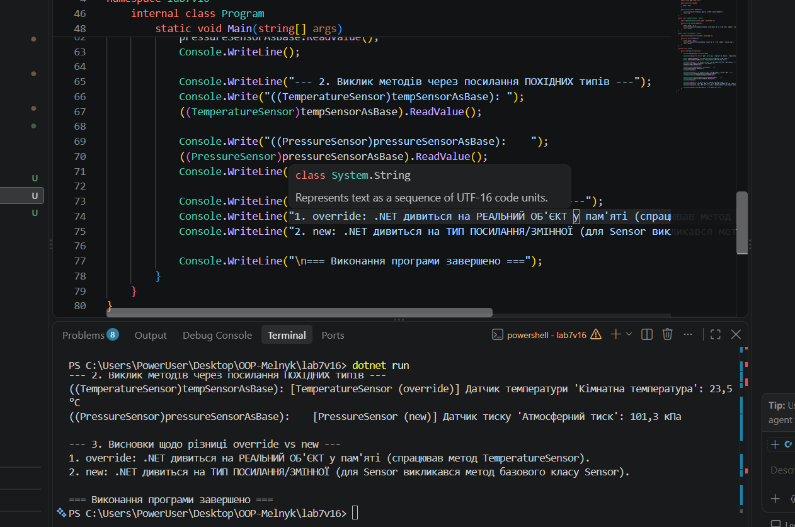

# Лабораторна робота №7

**Тема:** Приховування методів (new) vs перевизначення (override).  
**Студентка:** Мельник Ангеліна, група КН-3/1  
**Варіант:** 16 (Ієрархія `Sensor` -> `TemperatureSensor` / `PressureSensor`)

## Мета роботи
Зрозуміти різницю між приховуванням методів за допомогою ключового слова `new` та перевизначенням через `virtual`/`override`, а також навчитися правильно обирати між цими підходами.

## Хід роботи
1. Створено консольний проєкт `lab7v16` за допомогою .NET SDK.
2. Реалізовано базовий клас `Sensor` з віртуальним методом `ReadValue()`.
3. Реалізовано похідний клас `TemperatureSensor` (Клас A), який перевизначає метод `ReadValue()` за допомогою `override`.
4. Реалізовано похідний клас `PressureSensor` (Клас B), який приховує метод `ReadValue()` за допомогою `new`.
5. У методі `Main` продемонстровано виклик методів через посилання базового типу `Sensor` (upcasting) та через явне приведення до похідних типів, що наочно показує відсутність поліморфізму при використанні `new`.

## Результат виконання програми

