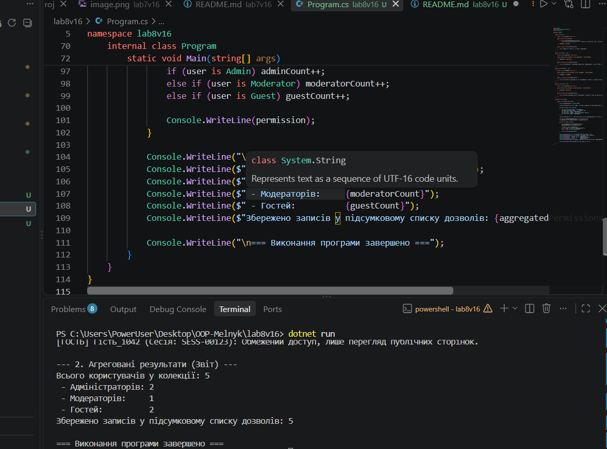

# Лабораторна робота №8

**Тема:** Поліморфізм: динамічне зв’язування та перевизначення методів.  
**Студентка:** Мельник Ангеліна, група КН-3/1  
**Варіант:** 16 (Ієрархія `User` -> `Admin`, `Moderator`, `Guest`)

## Мета роботи
Навчитися реалізовувати поліморфну поведінку за допомогою віртуальних методів та їх перевизначення, а також агрегувати результати поліморфних викликів.

## Хід роботи
1. Створено консольний проєкт `lab8v16` за допомогою .NET SDK.
2. Реалізовано базовий клас `User` з віртуальним методом `GetPermissions()`.
3. Реалізовано 3 похідні класи: `Admin`, `Moderator` та `Guest`, які перевизначають (`override`) метод `GetPermissions()`.
4. У методі `Main` створено колекцію `List<User>`, куди додано екземпляри всіх трьох похідних класів.
5. За допомогою циклу `foreach` виконано поліморфний виклик методу `GetPermissions()` та збережено (агреговано) всі результати у підсумковий список і зібрано статистику типів користувачів.

## Результат виконання програми

