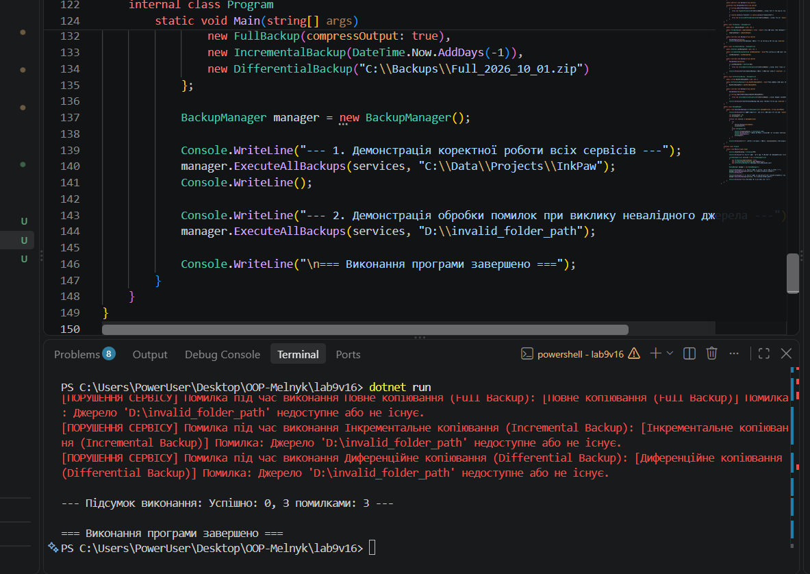

# Лабораторна робота №9

**Тема:** Поліморфні сервіси: Резервне копіювання (`BackupService`).  
**Студентка:** Мельник Ангеліна, група КН-3/1  
**Варіант:** 16 (Ієрархія `BackupService` -> `FullBackup`, `IncrementalBackup`, `DifferentialBackup`)

## Мета роботи
Застосувати поліморфізм для створення системи резервного копіювання з різними стратегіями зберігання даних, навчитися обробляти помилки в поліморфних класах та використовувати списки базового типу для роботи з різними реалізаціями.

## Хід роботи
1. Створено консольний проєкт `lab9v16` за допомогою .NET SDK.
2. Реалізовано абстрактний базовий клас `BackupService` з абстрактним методом `Backup(string source)` та захищеним методом валідації джерела.
3. Реалізовано 3 похідні класи з власною логікою копіювання та валідацією:
   - `FullBackup`: здійснює повне копіювання з можливістю стиснення.
   - `IncrementalBackup`: здійснює копіювання лише змінених файлів з дати останнього бэкапу.
   - `DifferentialBackup`: копіює відмінності відносно базового повного архіву.
4. Створено клас-сервіс `BackupManager` з методом `ExecuteAllBackups`, який приймає список `List<BackupService>` і поліморфно викликає бэкап для кожного елемента в блоці `try-catch`.
5. У методі `Main` продемонстровано успішне виконання пакетного копіювання та обробку помилки при передачі неіснуючого шляху.

## Результат виконання програми

